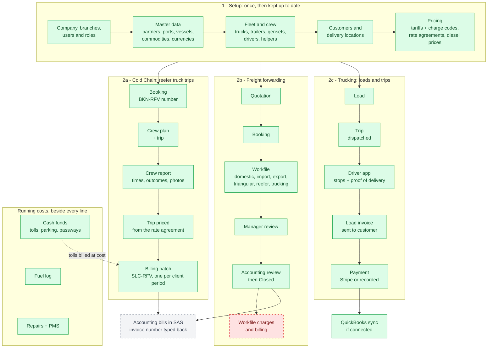
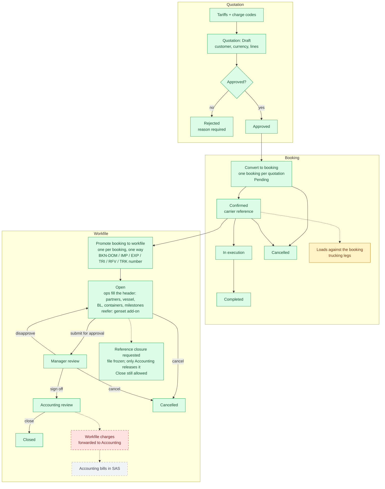
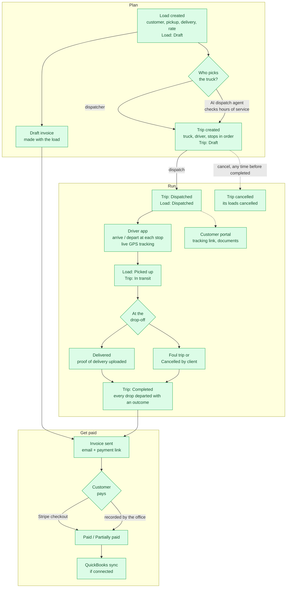

# Business Flows

How work moves through TrackWise from start to finish, one chart per business line. Each chart is
[Mermaid](https://mermaid.js.org/) code: GitHub renders it in place, and you can paste any block
into [mermaid.live](https://mermaid.live) to view, edit, or export it as PNG/SVG. The rendered images
are in [images/flows/](images/flows/).

Colours, in every chart:

- **Green** - built and in use
- **Amber** - built, but with a known gap (noted on the box)
- **Red, dashed** - not built yet
- **Grey, dashed** - happens outside TrackWise (SAS, the driver's Messenger report)

Keep these charts in step with the code. When a status, rule or handoff changes, change the chart in
the same commit. Statuses and rules come from the domain entities named under each chart.

1. [Overview](#1-overview) - setup, the three business lines, and where each one ends
2. [Cold Chain](#2-cold-chain) - reefer truck trips, billed in batches per client period
3. [Freight forwarding](#3-freight-forwarding) - quotation, booking, workfile
4. [Trucking](#4-trucking) - loads, trips, the driver app, invoices and payments

## 1. Overview

## 2. Cold Chain

One booking is one truck-trip for one client on one day. Cold Chain bookings never get a workfile:
their trips are billed together, one batch per client billing period.

This chart uses Mermaid's ELK layout (the `config` header) so it reads top to bottom. mermaid.live
draws it that way; a viewer without ELK falls back to the default layout, which still works but
spreads diagonally. [2-cold-chain.png](images/flows/2-cold-chain.png) is the clean copy.

```mermaid
---
config:
  layout: elk
---
flowchart TD
    classDef built fill:#dcfce7,stroke:#16a34a,color:#14532d
    classDef partial fill:#fef3c7,stroke:#d97706,color:#78350f
    classDef missing fill:#fee2e2,stroke:#dc2626,color:#7f1d1d,stroke-dasharray:5 5
    classDef outside fill:#f3f4f6,stroke:#9ca3af,color:#374151,stroke-dasharray:5 5

    subgraph BOOK["Booking"]
        RA["Client's rate agreement<br/>Draft → Active<br/>a price change is a new revision"]
        DP["Diesel price<br/>of the service date"]
        BK["Office creates the booking<br/>date, truck size, pickup warehouse,<br/>drops, commodity, temperature<br/>BKN-RFV number + live price estimate"]
        SO["Standing order<br/>copy a booking onto chosen days"]
        RA --> BK
        DP --> BK
        BK -.-> SO
        SO -.->|"one new booking per day"| BK
        BK --> PEN["Pending"]
        PEN --> Q1{"Client<br/>confirms?"}
        Q1 -->|"not yet"| HOLD["Hold / Resched"]
        HOLD --> Q1
        Q1 -->|"yes"| CON["Confirmed"]
        Q1 -->|"no"| LOST["Cancelled, Lost or No booking<br/>loss reason required"]
        CON -->|"called off"| LOST
    end

    subgraph DISPATCH["Dispatch"]
        BB["Booking board<br/>Crew Plan > Bookings tab<br/>confirmed bookings with no trip yet"]
        CP["Crew plan for the day<br/>per truck: status, driver, up to 2 helpers<br/>absent / on-leave crew can't be picked"]
        TRIP["Create trip from booking<br/>one load per drop, crew from the crew plan<br/>Booking: In execution"]
        PR["Trip priced at once<br/>costliest drop's rate + fuel surcharge<br/>+ extra-drop fees<br/>foul-trip % if every drop failed"]
        TDS["Trip: Draft → Dispatched"]
        TCAN["Trip cancelled<br/>booking back to Confirmed"]
        CON --> BB
        BB --> TRIP
        CP --> TRIP
        TRIP --> PR
        PR --> TDS
        TDS -.->|"before it completes"| TCAN
    end

    subgraph RUN["The run"]
        MSG["Driver reports in Messenger<br/>times from GreatJ GPS"]
        CR["Office types the crew report<br/>truck / crew / drops editable<br/>until the first arrival"]
        WH["Warehouse<br/>arrival, loading, departure<br/>+ inspection photos<br/>Trip: In transit"]
        DROP["Each drop<br/>arrival, departure<br/>+ proof-of-delivery photos"]
        OUT{"Drop<br/>outcome"}
        GAR["Garage times"]
        DONE["Trip: Completed<br/>every drop departed with an outcome<br/>Booking: Completed"]
        COR["Correction<br/>reason required, kept as history"]
        OOD["Price out of date<br/>after a corrected outcome, a drop added<br/>or removed, or a different-size truck<br/>re-price on the trip"]
        TDS --> CR
        MSG -.-> CR
        CR --> WH
        WH --> DROP
        DROP --> OUT
        OUT -->|"Delivered"| GAR
        OUT -->|"Foul trip"| GAR
        OUT -->|"Cancelled by client"| GAR
        GAR --> DONE
        CR -.->|"a recorded time or<br/>outcome was wrong"| COR
        COR -.-> OOD
    end

    subgraph BILL["Billing"]
        BD["Billing batch: Draft<br/>one client, one period<br/>1-15 / 16-end, weekly or monthly<br/>trips follow their latest price"]
        CHG["Other charges<br/>demurrage, backload, different location,<br/>tolls + parking from cash funds"]
        PAP["Client papers checklist<br/>before locking"]
        LCK["Locked<br/>refused while any trip is unfinished,<br/>unpriced or out of date<br/>can unlock back to Draft, with reason"]
        FWD["Forwarded<br/>PDF summary printed for Accounting<br/>SLC-RFV number<br/>can unlock back to Draft, with reason"]
        XLS["nSFS Excel transmittal"]
        SAS["Accounting bills the client in SAS"]
        BLD["Billed<br/>SAS invoice number typed in"]
        CAN["Cancelled<br/>any time before Billed<br/>trips freed, reference kept"]
        DONE --> BD
        CHG --> BD
        BD --> LCK
        PAP -.-> LCK
        LCK --> FWD
        FWD --> SAS
        FWD -.-> XLS
        SAS --> BLD
        BD -->|"cancel, with reason"| CAN
    end

    class RA,DP,BK,SO,PEN,Q1,HOLD,CON,LOST,BB,CP,TRIP,PR,TDS,TCAN,CR,WH,DROP,OUT,GAR,DONE,COR,OOD,BD,CHG,LCK,FWD,BLD,CAN built
    class PAP,XLS missing
    class MSG,SAS outside
```

Sources: `Booking.cs`, `Booking.RateAgreement.cs`, `CreateTripFromBookingHandler`, `CrewAssignment`,
`Trip.Status.cs`, `Trip.Corrections.cs`, `Trip.Pricing.cs`, `RatePricer`, `BillingBatch.Status.cs`.
Known gap: every drop's load still gets its own draft load invoice, which Cold Chain doesn't use.

## 3. Freight forwarding

Domestic, import, export, triangular and reefer files, plus trucking files. The workfile type decides
its reference series and rules (`WorkfileRules`, `WorkfileSeries`).

Sources: `Quotation.cs`, `Booking.cs`, `LoadService.CreateLoadsAsync`, `Workfile.Status.cs`,
`WorkfileStatusMachine`. Known gaps: loads can be tied to a booking through the API but there is no
screen for it; workfiles have no charges yet, so "forward to Accounting" moves the file without any
amounts; Accounting has no way to send a file back.

## 4. Trucking

The original core: loads and trips, with the driver app recording each stop.

Sources: `Load`, `LoadFactory.CreateInvoice`, `Trip.Status.cs`, `TripStatusMachine`, `Invoice.cs`.
At Skybest the driver app isn't used yet: drivers report by Messenger and the office records the trip
(see the Cold Chain chart).
