# Quotation Flowchart — refactor/quotation-life-cycle-improvement

```mermaid
flowchart TD
  %% ===== ENTRY: UI ROUTES =====
  subgraph ENTRY ["1. UI Entry Points — TMS Portal (Angular 22, Signal Forms)"]
    direction LR
    LIST["/quotations<br/>QuotationsListComponent<br/>QuotationsListStore (lazy table)"]
    ADD["/quotations/add<br/>QuotationAddComponent<br/>→ QuotationForm"]
    DET["/quotations/:id<br/>QuotationDetailsComponent<br/>status-gated action bar"]
    EDIT["/quotations/:id/edit<br/>QuotationEditComponent<br/>QuotationForm (resource loader)"]
    LIST -->|"click row / Add Quotation"| ADD
    LIST -->|"click row"| DET
    DET -->|"Edit button"| EDIT
  end

  %% ===== FORM =====
  subgraph FORM ["QuotationForm — Signal Form (form()/FormField/FormRoot/ValidatedForm)"]
    direction TB
    F1["Section 1: Customer · Freight Mode · Incoterm · Currency"]
    F2["Section 2: Transport Mode · Shipment Type · Routing<br/>point-to-point OR multi-stop (RouteStopDialog)"]
    F3["Section 3: Cargo Specs (commodity, pallets, weight, value)"]
    F4["Section 4: Cold Chain & Telematics<br/>progressive disclosure on requiresActiveRefrigeration"]
    F5["Section 5: Notes + Submit"]
    F1 --> F2 --> F3 --> F4 --> F5
    F1 -.->|"freightMode change"| PRESET["handleFreightModeChange()<br/>domestic→PHP/FCA/road/ftl<br/>import/export/triangular→USD/customs/ocean/fcl"]
    F2 -.->|"transportMode change"| AUTOFIX["handleTransportModeChange()<br/>auto-corrects shipmentType"]
    F5 -->|"form submit"| EMIT["save.emit(CreateQuotationCommand)"]
  end

  %% ===== CONTROLLER =====
  subgraph CTRL ["2. API Controller — QuotationController [Route('quotations')]"]
    direction TB
    C_GET["GET /quotations<br/>GetQuotationsQuery<br/>[Permission.Quotation.View]"]
    C_GET1["GET /quotations/{id}<br/>GetQuotationByIdQuery<br/>[Permission.Quotation.View]"]
    C_CREATE["POST /quotations<br/>CreateQuotationCommand<br/>[Permission.Quotation.Manage]"]
    C_REV["POST /quotations/{id}/revisions<br/>CreateQuotationRevisionCommand<br/>[Permission.Quotation.Manage]"]
    C_UPDATE["PUT /quotations/{id}<br/>UpdateQuotationCommand<br/>[Permission.Quotation.Manage]"]
    C_ADDL["POST /quotations/{id}/lines<br/>AddQuotationLineCommand<br/>[Permission.Quotation.Manage]"]
    C_REML["DELETE /quotations/{id}/lines/{lineId}<br/>[Permission.Quotation.Manage]"]
    C_SUB["POST /quotations/{id}/submit<br/>[Permission.Quotation.Manage]"]
    C_APV["POST /quotations/{id}/approve<br/>[Permission.Quotation.Manage]"]
    C_RJ["POST /quotations/{id}/reject<br/>RejectQuotationRequest{reason}<br/>[Permission.Quotation.Manage]"]
    C_ISS["POST /quotations/{id}/issue<br/>IssueQuotationRequest{validityDays}<br/>[Permission.Quotation.Manage]"]
    C_AC["POST /quotations/{id}/accept<br/>[Permission.Quotation.Manage]"]
    C_EXP["POST /quotations/{id}/expire<br/>[Permission.Quotation.Manage]"]
    C_CONV["POST /quotations/{id}/convert-to-booking<br/>ConvertQuotationToBookingRequest<br/>[Permission.Booking.Manage]"]
    C_PDF["GET /quotations/{id}/pdf<br/>GenerateQuotationPdfCommand<br/>[Permission.Quotation.View]"]
  end

  %% ===== HANDLERS =====
  subgraph HANDLERS ["3. Application Handlers — MediatR (internal sealed)"]
    direction TB
    H_CREATE["CreateQuotationHandler<br/>customer+location validation, route resolver,<br/>Haversine distance, FX→PHP, Quotation.Create<br/>+ ratingEngine.AutoPriceAsync"]
    H_REV["CreateQuotationRevisionHandler<br/>latest non-draft only; copies same customer,<br/>freight mode, route and charge setup into new draft"]
    H_UPDATE["UpdateQuotationHandler<br/>Draft-only; ClearLines → UpdateDetails<br/>→ AutoPriceAsync"]
    H_ADDL["AddQuotationLineHandler<br/>Draft-only; tariff active & mode match;<br/>percentage base validation; AddLine"]
    H_REML["RemoveQuotationLineHandler<br/>Draft-only; RemoveLine"]
    H_SUB["SubmitQuotationHandler<br/>Draft-only, lines>0<br/>→ Quotation.Submit()"]
    H_APV["ApproveQuotationHandler<br/>Draft or PendingApproval<br/>→ Quotation.Approve(approvedBy)"]
    H_RJ["RejectQuotationHandler<br/>Draft/PendingApproval/Issued<br/>→ Quotation.Reject(by, reason)"]
    H_ISS["IssueQuotationHandler<br/>Approved-only; loads Lines→TariffRate→ChargeCode<br/>→ Quotation.Issue(validityDays)"]
    H_AC["AcceptQuotationHandler<br/>Issued-only<br/>→ Quotation.Accept()"]
    H_EXP["ExpireQuotationHandler<br/>Issued-only, past ValidUntil<br/>→ Quotation.Expire()"]
    H_CONV["ConvertQuotationToBookingHandler<br/>Accepted-only, not already booked<br/>→ Booking.CreateFromQuotation → AddAsync"]
    H_PDF["GenerateQuotationPdfHandler<br/>AsNoTracking load → QuotationPdfGenerator<br/>+ tenant logo + customer address"]
    H_GET["GetQuotationByIdHandler<br/>Include Lines→TariffRate→ChargeCode<br/>prices every line live; batch location names"]
  end

  %% ===== DOMAIN STATE MACHINE =====
  subgraph DOMAIN ["4. Domain Aggregate — Quotation (Quotation.cs)"]
    direction TB
    D_DRAFT["DRAFT<br/>Editable: UpdateDetails / AddLine / RemoveLine / ClearLines<br/>EvaluateApprovalRequirements() each mutation"]
    D_REV["Revision family<br/>immutable customer + freight mode + route<br/>copied lines can be repriced or replaced"]
    D_PEND["PENDING_APPROVAL<br/>RequiresSpecialApproval flag + reason<br/>escalation banner shown in UI"]
    D_APVD["APPROVED<br/>ApprovedBy / ApprovedAt set"]
    D_ISS["ISSUED<br/>SnapshotPrices() locks buying+selling<br/>IssuedAt + ValidUntil = now + validityDays"]
    D_ACPT["ACCEPTED<br/>AcceptedAt set — enables booking conversion"]
    D_REJ["REJECTED<br/>RejectedBy / RejectedAt / RejectionReason"]
    D_EXP["EXPIRED<br/>Manual expire, or auto-expire on Accept past ValidUntil"]
    D_AUTO["AUTO_DECLINED<br/>ENUM ONLY — no backend transition<br/>orphan state, no handler reaches it"]
  end

  %% ===== PERSISTENCE =====
  subgraph PERSIST ["5. Persistence"]
    direction TB
    P_UOW["TenantUnitOfWork (one DB per tenant)<br/>EF Core lazy loading ON — no .Include() except where shown"]
    P_IDX["DB index: (TenantId, ReferenceNumber)<br/>enforced in handler to close race"]
    P_EV["Domain events dispatched:<br/>QuotationCreated / SubmittedForApproval / Approved<br/>Issued / Expired / Accepted / Rejected / Updated"]
  end

  %% ===== WIRING: UI → Controller
  EMIT -->|"POST /quotations"| C_CREATE
  ADD -->|"POST /quotations"| C_CREATE
  DET -->|"Create Revision"| C_REV
  EDIT -->|"PUT /quotations/{id}"| C_UPDATE
  DET -.->|"GET /quotations/{id}"| C_GET1
  DET -.->|"GET /quotations"| C_GET
  LIST -.->|"GET /quotations"| C_GET
  DET -->|"Add Line dialog → POST .../lines"| C_ADDL
  DET -->|"trash icon → DELETE .../lines/{lineId}"| C_REML
  DET -->|"Submit for Approval"| C_SUB
  DET -->|"Approve"| C_APV
  DET -->|"Reject (reason dialog)"| C_RJ
  DET -->|"Issue (validityDays dialog)"| C_ISS
  DET -->|"Accept"| C_AC
  DET -->|"Expire"| C_EXP
  DET -->|"Convert to Booking dialog"| C_CONV
  DET -->|"Preview PDF"| C_PDF

  %% ===== WIRING: Controller → Handlers
  C_CREATE --> H_CREATE
  C_REV --> H_REV
  C_UPDATE --> H_UPDATE
  C_ADDL --> H_ADDL
  C_REML --> H_REML
  C_SUB --> H_SUB
  C_APV --> H_APV
  C_RJ --> H_RJ
  C_ISS --> H_ISS
  C_AC --> H_AC
  C_EXP --> H_EXP
  C_CONV --> H_CONV
  C_PDF --> H_PDF
  C_GET1 --> H_GET

  %% ===== WIRING: Handlers → Domain
  H_CREATE -->|"Quotation.Create()<br/>→ Draft"| D_DRAFT
  H_REV -->|"CreateRevision()<br/>new draft + copied charge setup"| D_REV
  D_REV --> D_DRAFT
  H_UPDATE -->|"ClearLines + UpdateDetails"| D_DRAFT
  H_ADDL -->|"AddLine"| D_DRAFT
  H_REML -->|"RemoveLine"| D_DRAFT
  H_SUB -->|"Submit()"| D_PEND
  H_SUB -.->|"no special approval"| D_APVD
  H_APV -->|"Approve()"| D_APVD
  H_RJ -->|"Reject()"| D_REJ
  H_ISS -->|"Issue() — snapshot prices"| D_ISS
  H_AC -->|"Accept() — checks ValidUntil"| D_ACPT
  H_EXP -->|"Expire()"| D_EXP
  H_CONV -->|"Booking.CreateFromQuotation"| D_ACPT

  %% ===== WIRING: Domain → Persistence
  D_DRAFT -->|"AddAsync / Update + SaveChanges"| P_UOW
  D_PEND -->|"Update + SaveChanges"| P_UOW
  D_APVD -->|"Update + SaveChanges"| P_UOW
  D_ISS -->|"Update + SaveChanges"| P_UOW
  D_ACPT -->|"Update + SaveChanges"| P_UOW
  D_REJ -->|"Update + SaveChanges"| P_UOW
  D_DRAFT -->|"QuotationCreated / Updated"| P_EV
  D_PEND -->|"QuotationSubmittedForApproval"| P_EV
  D_APVD -->|"QuotationApproved"| P_EV
  D_ISS -->|"QuotationIssued"| P_EV
  D_EXP -->|"QuotationExpired"| P_EV
  D_ACPT -->|"QuotationAccepted"| P_EV
  D_REJ -->|"QuotationRejected"| P_EV
  P_UOW -->|"ReferenceNumber"| P_IDX

  H_REV -.->|"PreviousRevisionId / RevisionGroupId"| P_UOW

  %% ===== STYLE / STATE MACHINE LEGEND
  classDef draft fill:#f1f5f9,stroke:#94a3b8,color:#1e293b
  classDef gate fill:#fef3c7,stroke:#f59e0b,color:#78350f
  classDef terminal fill:#fee2e2,stroke:#dc2626,color:#7f1d1d
  classDef orphan fill:#fafafa,stroke:#cbd5e1,color:#64748b,stroke-dasharray:5 5
  class D_DRAFT draft
  class D_PEND gate
  class D_APVD gate
  class D_ISS gate
  class D_ACPT gate
  class D_REJ terminal
  class D_EXP terminal
  class D_AUTO orphan
```

**How to read it** — four layers stacked top-to-bottom, arrows flow downward:

1. **UI entry** — 4 lazy routes. The list page is a lazy `ui-data-table` driven by `QuotationsListStore`. Add/edit both render `QuotationForm`; details page owns the status-gated action bar.
2. **Controller** — 14 REST endpoints under `POST /quotations/{id}/{action}` for lifecycle verbs, `GET` for list/detail/pdf. Every write is `[Permission.Quotation.Manage]`; the convert endpoint is `[Permission.Booking.Manage]`.
3. **Handlers** — one MediatR handler per command. Each is `internal sealed`, owns its `SaveChangesAsync`, and translates domain exceptions into `Result.Fail` with an `errorCode`.
4. **Domain** — the `Quotation` aggregate enforces the state machine; `EvaluateApprovalRequirements()` runs on every mutation and sets `RequiresSpecialApproval` (high-value cargo ≥ ₱30M, hazardous, cryogenic, air charter).
5. **Persistence** — tenant-scoped UoW, one DB per tenant, reference-number uniqueness enforced in-handler.

**Notable flow details** the chart encodes:

- **Submit is a fork**: `Quotation.Submit()` routes to `PendingApproval` when `RequiresSpecialApproval`, otherwise **auto-approves** straight to `Approved` (`ApprovedBy = "SYSTEM_AUTO_APPROVER"`) — so the Approve button in the UI is a no-op for standard quotes.
- **Approve accepts both Draft and PendingApproval** (supports escalated quotes and direct draft review).
- **Issue snapshots prices** — `SnapshotPrices()` locks buying/selling per line so tariff drift after issue can't change the offer.
- **Accept validates `ValidUntil`** — if past expiry it flips to `Expired` and throws, so the client sees a failed call rather than a stale acceptance.
- **Repeat bookings** — acceptance creates the initial draft booking; the accepted quotation's explicit repeat action creates another draft with a distinct booking number and the quotation's locked price snapshots.
- **AutoDeclined is a dead state** — it exists in the enum and the UI badge mapping, but no handler transitions into it; nothing reaches it from the backend.
- **Currency lock in Draft** — `UpdateDetails` refuses a currency change while priced lines exist; `UpdateQuotationHandler` calls `ClearLines()` first, then reprices via the rating engine.
- **Multi-stop routing**: `routingMode` (point-to-point vs multi-stop) is derived from stop types; `handleFreightModeChange` auto-populates presets (currency, incoterm, mode, shipment type) per freight mode; `handleTransportModeChange` auto-corrects shipment type to valid options for the selected transport mode.
- **Cold chain progressive disclosure**: `isColdChainRequired()` gate reveals Sections 3b (Temperature Zone, Setpoint, Variance, Compliance, Continuous Telematics) only when `requiresActiveRefrigeration` is true.
- **PDF generation**: `GenerateQuotationPdfHandler` loads quotation as `AsNoTracking`, resolves tenant logo + customer address + location names, and passes to `QuotationPdfDocument` (QuestPDF) which prices every line through the aggregate, handles percentage/CIF/BAS bases, and prints a full formal rate offer with routing, cargo profile, cold chain profile, line items table, totals, notes, and validity block with signatures.
